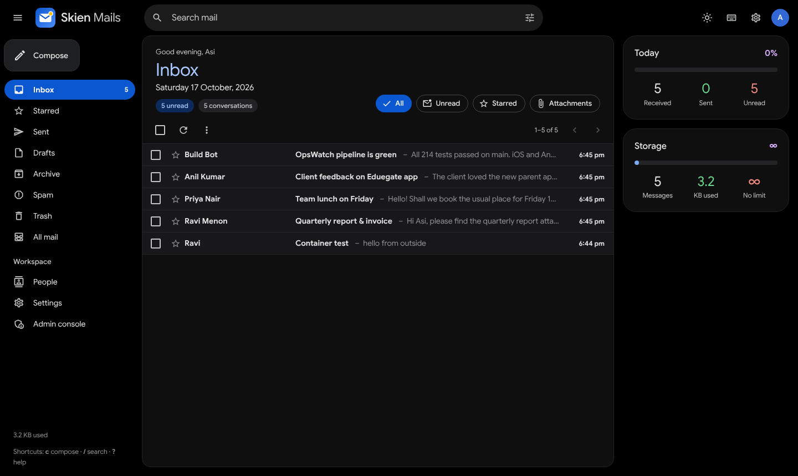
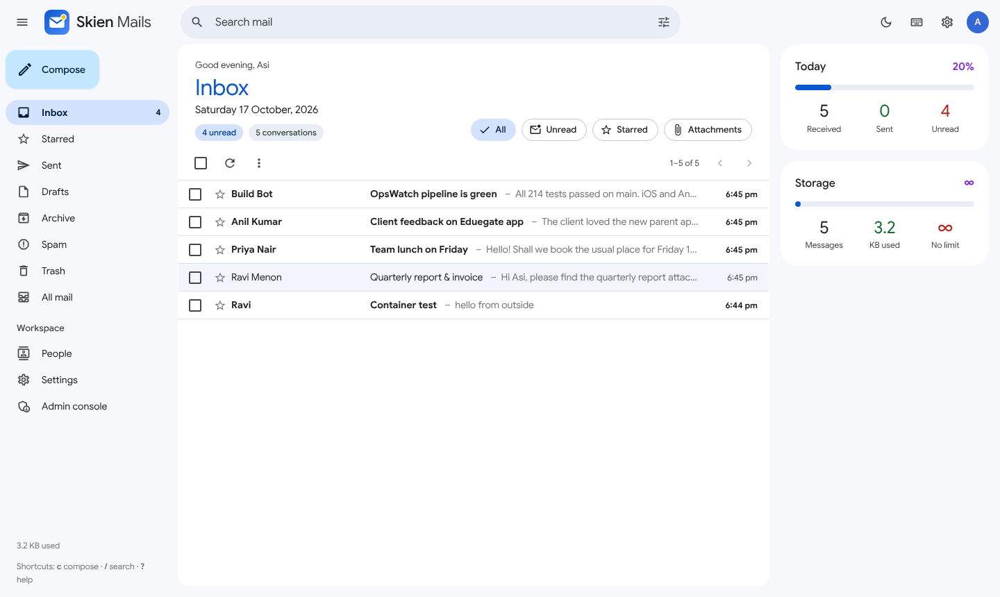
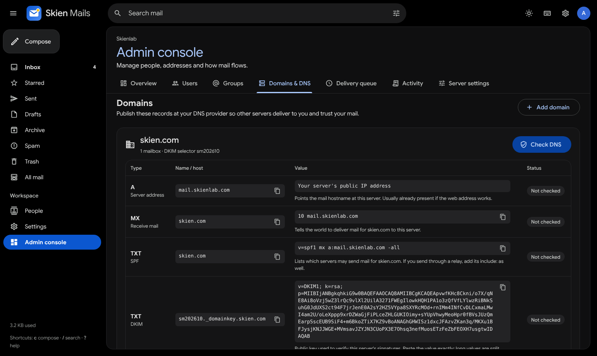
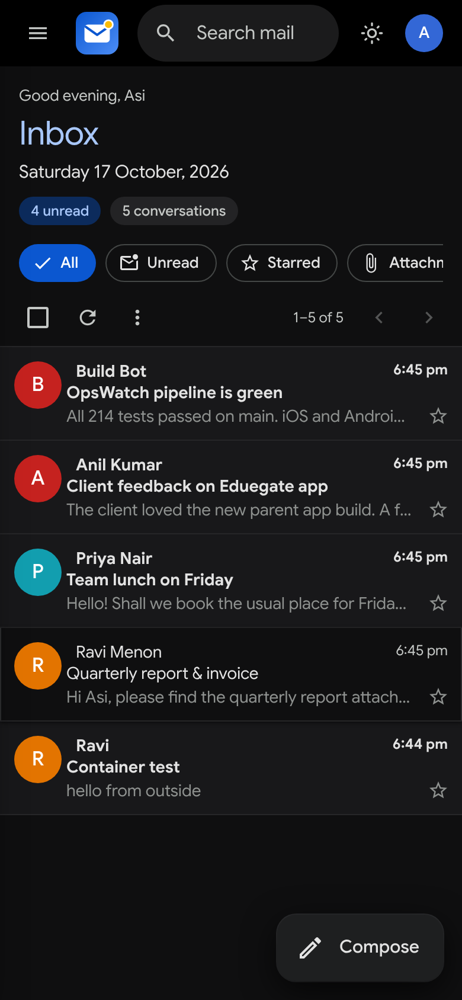

# Skien Mails

Email for your organisation, built from scratch: a complete mail server, webmail and admin console in **one small Docker container**.

- **Mail server**: receives mail on port 25, delivers outgoing mail itself (or through a relay), lets apps send through ports 587/465, and lets Outlook, Apple Mail, Thunderbird and phone mail apps read mail over IMAP (993/143).
- **Trusted mail**: every outgoing message is DKIM-signed. Incoming mail is checked with SPF, DKIM and DMARC, reverse DNS and blocklists. Spam goes to the Spam folder, and forged mail claiming to be from your own domain is rejected.
- **Webmail**: a Material-style app with light and dark themes. It has conversations, search (`from:`, `has:attachment`, `is:unread`…), stars, archive, your own folders, filters that sort new mail, blocked and always-allowed senders, rich-text compose with attachments, drafts that save themselves, undo send, signatures, out-of-office replies, keyboard shortcuts, live updates, mail import and a one-click mailbox export.
- **Admin console**: users, groups (info@, team@ with "send as"), domains with DNS record checks, the delivery queue, an activity log, mail traffic and server settings.
- **Installable app**: works on Windows, macOS, Android and iPhone, with an unread badge, `mailto:` handling and new-mail notifications, also while the app is closed (Web Push, end-to-end encrypted).
- **Small and fast**: one Go binary with SQLite (WAL) and full-text search. It idles at about 30 MB of RAM, and the inbox loads in about 10 ms even under load.

| Inbox (dark) | Inbox (light) |
|---|---|
|  |  |
| **Admin console: DNS records** | **Phone** |
|  |  |

```
┌────────────────────────── skienmail container ──────────────────────────┐
│  :25  inbound MX ──► SPF/DKIM/DMARC + spam score ──► mailbox (SQLite+.eml)  │
│  :587/:465 submission (auth) ─┐   :993/:143 IMAP for mail apps ◄─ mailbox  │
│  :8080 web app + JSON API ────┴─► local delivery / DKIM sign ─► queue ─► internet │
│                                   retries for 4 days, bounces on failure   │
│  /data  skienmail.db · mail/ · queue/ · uploads/ · avatars/ · certs/       │
└──────────────────────────────────────────────────────────────────────────┘
```

---

## 1. Before you start: the server

| Need | Why |
|---|---|
| A Linux server with Docker and a **static public IP** | Other mail servers connect to it |
| **Inbound port 25** open in your firewall or security group | To receive mail |
| **Outbound port 25** allowed by your provider | To deliver mail directly. **Google Cloud, AWS and Azure block it.** On those, use a relay (step 6). After setup, *Admin console → Overview → Test port 25* tells you which case you're in. |
| Ports 587 and 465 (optional) | Only for phones, printers or scripts that send mail through the server |
| Ports 993 and 143 (optional) | Only for mail apps (Outlook, Apple Mail, Thunderbird, phone mail apps) that read mail over IMAP |
| Reverse DNS (PTR) for the IP | Gmail and Outlook reject mail from IPs without it. You set it at your hosting provider. |

## 2. Install

### Option A: Skienlab server via GitHub Actions (how we deploy)

This uses the same flow as the other Skienlab apps: **Actions → Build & Deploy Skien Mails → Run workflow**. It runs the tests, builds the image, pushes it to Artifact Registry (`test-images/mailserver`, tagged `latest` plus the commit SHA), then SSHes to the VM, pulls and restarts the container, and fails the run if the container doesn't report healthy.

One-time setup:

1. **Repository secrets** (*Settings → Secrets and variables → Actions*): `GCP_SA_KEY`, `GCP_PROJECT_ID`, `VM_HOST`, `VM_USER`, `VM_SSH_KEY`. Use the same values as the tasks repo, unless they're already organisation secrets.
2. **On the VM**, create the app folder and compose file:
   ```bash
   mkdir -p ~/docker/apps/mailserver
   # copy docker-compose.yml from this repo to ~/docker/apps/mailserver/docker-compose.yml
   sudo ss -ltnp | grep -E ':(25|143|465|587|993)\b'   # must print nothing: no other mail server on these ports
   ```
3. **Firewall**: allow inbound TCP 25, 587, 465, 993 and 143 to the VM, in both the provider's firewall and `ufw` if it's enabled (993 and 143 are only needed for mail apps).
4. Run the workflow, then get the setup code:
   ```bash
   docker logs skienmail 2>&1 | grep "setup code"
   ```
   (The workflow never prints this code, because this repo's Actions logs are public.)
5. In Nginx Proxy Manager, add `mail.skienlab.com` → `http://skienmail:8080` (step 3 below). The container sits on `skiensuite-net` like the other apps, so there's no web port to publish.

To roll back, change `:latest` in the VM's compose file to a previous commit tag (e.g. `:8f1877f`) and run `docker compose up -d`.

### Option B: build and run it anywhere (e.g. to try it locally)

`docker-compose.yml` is the Skienlab server's file (pre-built image, `skiensuite-net`). To run your own build instead:

```bash
git clone https://github.com/skienlabs/mailserver.git
cd mailserver
docker build -t skienmail .
docker run -d --name skienmail --restart unless-stopped \
  -p 25:25 -p 587:587 -p 465:465 -p 993:993 -p 143:143 -p 8080:8080 \
  -e SM_HOSTNAME=mail.example.com -v skienmail-data:/data skienmail
docker logs skienmail 2>&1 | grep "setup code"
```

## 3. HTTPS with Nginx Proxy Manager

Add a **Proxy Host**:

- Domain: `mail.skienlab.com`
- Scheme `http`, forward host `skienmail` if Nginx Proxy Manager is on the same Docker network (see the commented `networks:` in `docker-compose.yml`), otherwise the server's IP. Port `8080`.
- SSL tab: request a Let's Encrypt certificate, then turn on **Force SSL** and **HTTP/2**.
- Advanced tab (recommended, so live updates arrive instantly):
  ```nginx
  proxy_buffering off;
  proxy_read_timeout 1h;
  client_max_body_size 40m;
  ```

Open `https://mail.skienlab.com`. The setup wizard asks for:

1. Your organisation name, the **email domain** (the part after `@`, e.g. `skien.com`) and the **web address** (`mail.skienlab.com`).
2. Your administrator account, e.g. `asi@skien.com`.
3. The setup code from the server log.

> The email domain and web address can differ. Addresses can be `@skien.com` while the server lives at `mail.skienlab.com`, because the MX record connects them.

## 4. DNS records

*Admin console → Domains & DNS* lists every record with your real values and copy buttons. **Check DNS** verifies them live. For `skien.com` served from `mail.skienlab.com` the records look like this:

| Type | Name | Value |
|---|---|---|
| A | `mail.skienlab.com` | your server IP |
| MX | `skien.com` | `10 mail.skienlab.com` |
| TXT (SPF) | `skien.com` | `v=spf1 mx a:mail.skienlab.com -all` |
| TXT (DKIM) | `smYYYYMM._domainkey.skien.com` | `v=DKIM1; k=rsa; p=…` (copy it from the console) |
| TXT (DMARC) | `_dmarc.skien.com` | `v=DMARC1; p=quarantine; adkim=r; aspf=r` |
| PTR | your server IP | `mail.skienlab.com` (set at the hosting provider) |

After that, send a message to a Gmail address and choose *Show original* in Gmail. You should see **SPF: PASS, DKIM: PASS, DMARC: PASS**.

## 5. Add your team

*Admin console → Users → Add user*. Skien Mails creates a temporary password and gives you a ready-to-share message:

```
Sign in at:  https://mail.skienlab.com
Email:       sajin@skien.com
Password:    Kiva-7Rp2-Tumo-x9Qa
```

Each employee must choose their own password the first time they sign in. After that they can manage their profile, photo, signature, password, active sessions and out-of-office reply in **Settings**.

**Groups** (`info@`, `team@`, `support@`) deliver to several people. Members you allow can also send as the group from the **From** menu in compose.

### Bringing over old mail (Zoho, Gmail, others)

Each person can import their old mail in **Settings → Import & export**. Their old account isn't changed.

- **From the old account (recommended for Zoho).** Pick the provider (Zoho company domain or @zohomail, data centre India / US / Europe, Gmail, Yahoo or any IMAP server), sign in, choose where each folder goes, and start. Folders, read status, stars and original dates are kept. In Zoho, first turn on *Settings → Mail Accounts → IMAP Access*. If the account uses two-step verification, use an app-specific password. The password is used only for that import and isn't stored.
- **From a file.** Upload a Zoho export (*Zoho Mail → Settings → Import/Export → Export*, a `.zip` of `.eml` files), a Google Takeout or Thunderbird `.mbox`, or a single `.eml`. Large files are uploaded in parts and resume after a dropped connection; up to 20 GB per file.

Imports run in the background. Running one again is safe because messages already in the mailbox are skipped. Imported mail counts toward the mailbox size limit; an import stops cleanly when the mailbox is full.

**Export.** In the same tab, *Export your mail* downloads a `.zip` with one folder per mail folder and one `.eml` file per message (plus a `messages.csv` index). Outlook, Apple Mail and Thunderbird open `.eml` files, and the `.zip` can be imported back here or into another service.

### Folders, filters and blocked senders

In **Settings → Filters & blocked** (or from the side menu and a message's ⋮ menu):

- **Folders**: create, rename (use `/` for subfolders, e.g. `Clients/Acme`) and delete. Deleting a folder moves its mail to Archive. Move conversations with **Move to** or the `v` key.
- **Filters**: sort new mail as it arrives by sender, recipient, subject or words, then move it to a folder, mark it read or star it. All conditions must match; within one condition, commas mean "or". Filters run top to bottom, and the first one that moves a message decides its folder. A new filter can also be applied to mail you already have (Inbox, Archive and your own folders).
- **Blocked senders** go straight to Spam; **always allowed** senders skip the spam filter when the message is verified as really coming from their domain (SPF or DKIM), so forged copies still go to Spam. Both accept an address or a whole domain.

### Mail apps (Outlook, Apple Mail, Thunderbird, phones)

Each person finds their settings in **Settings → Email apps**: server `mail.skienlab.com`, IMAP on 993 (SSL/TLS) or 143 (STARTTLS), SMTP on 465 (SSL/TLS) or 587 (STARTTLS), username = email address, password = their Skien Mails password. Folders, read status, stars and moves stay in sync with the web app. Deleting in a mail app moves mail to Trash. Mail apps need a real TLS certificate (step 7), so set that up before announcing it. New mail shows up as fast as the app checks: Thunderbird and Apple Mail on a Mac are told about new mail at once (IMAP IDLE), while many phone apps, such as the Gmail app and iPhone Mail, check on a schedule (every 15 minutes by default in the Gmail app). For instant alerts on a phone, install Skien Mails from the browser and turn on notifications.

### Notifications when the app is closed

In **Settings → General → Notifications**, each person turns on *When Skien Mails is closed* on every phone or computer they want notified. It works in Chrome, Edge and Firefox on Windows, macOS, Linux and Android, in Safari on macOS, and on iPhone and iPad once Skien Mails has been added to the Home Screen. A burst of mail becomes one notification, nothing is sent for mail that's already read or goes to Spam, and *Show sender and subject* can be turned off for shared screens. Notifications stop on a device when someone signs out there, and changing the password stops them on every other device. The notification content is encrypted for that device only; the browser's push service (Google, Mozilla, Apple, Microsoft) can't read it. The server needs outbound HTTPS to those services.

### Installing the app on Windows

Open `https://mail.skienlab.com` in Edge or Chrome and click **Install** (the icon at the right end of the address bar). You can also open the account menu and choose **Install Skien Mails app**. It gets its own window and taskbar icon, shows an unread badge, and handles `mailto:` links.

## 6. Outgoing relay (only if port 25 is blocked)

Go to *Admin console → Server settings → Outgoing relay*. Enter your relay provider's host, port, username and password: for example Amazon SES (`email-smtp.ap-south-1.amazonaws.com:587`), Brevo (`smtp-relay.brevo.com:587`) or Mailgun. Then add the provider's `include:` to your SPF record, e.g. `v=spf1 mx include:amazonses.com -all`.

## 7. TLS certificate for SMTP and IMAP

Mail between servers is always encrypted with STARTTLS. Without configuration the server uses a self-signed certificate, which other mail servers accept. Phones and desktop mail apps connecting on 587/465 (sending) and 993/143 (reading) need a real certificate, so reuse the one Nginx Proxy Manager already renews:

```yaml
    environment:
      SM_TLS_CERT: /certs/live/npm-1/fullchain.pem   # npm-N = the certificate ID shown in NPM
      SM_TLS_KEY:  /certs/live/npm-1/privkey.pem
    volumes:
      - /path/to/nginx-proxy-manager/letsencrypt:/certs:ro
    user: "0:0"   # Let's Encrypt keys are readable by root only
```

Renewed certificates are picked up automatically within a minute. If Nginx Proxy Manager doesn't run on the same server, set `SM_ACME=true`, publish ports 80 and 443 instead of 8080, and Skien Mails gets its own Let's Encrypt certificate.

## Configuration (environment variables)

| Variable | Default | Meaning |
|---|---|---|
| `SM_DATA_DIR` | `/data` | Where everything is stored |
| `SM_HOSTNAME` | (from setup) | Public name of the server. Overrides the setting in the console. |
| `SM_HTTP_ADDR` | `:8080` | Web app listener (`off` to disable) |
| `SM_SMTP_ADDR` / `SM_SUBMISSION_ADDR` / `SM_SUBMISSIONS_ADDR` | `:25` / `:587` / `:465` | SMTP listeners (`off` to disable) |
| `SM_IMAPS_ADDR` / `SM_IMAP_ADDR` | `:993` / `:143` | IMAP listeners for mail apps, TLS / STARTTLS (`off` to disable). If a port can't be opened the error is logged and everything else keeps running. |
| `SM_TLS_CERT`, `SM_TLS_KEY` | | PEM certificate and key for SMTP and IMAP TLS |
| `SM_ACME`, `SM_ACME_EMAIL` | `false` | Built-in Let's Encrypt (serves HTTPS on `:443` itself) |
| `SM_TRUST_PROXY` | `true` | Trust `X-Forwarded-*` headers from private-network proxies |
| `SM_SETUP_TOKEN` | random | Fixed setup code, if you prefer |
| `SM_MAX_MESSAGE_MB` | `25` | Default message size limit |
| `SM_DB_CACHE_MB` | `64` | Database page cache per connection (up to 8 connections). Raise it on large servers (e.g. `256` with 32 GB RAM); lower it on very small ones. |
| `SM_QUEUE_WORKERS` | `16` | Outgoing deliveries that run at the same time (1–256). |
| `SM_QUEUE_PER_DOMAIN` | `4` | Of those, how many may go to one destination at once (1–64), so big providers don't throttle the server. |
| `SM_DEBUG` | `false` | Verbose logging |

## Operations

```bash
# Locked out? Give any account (including the admin) a new temporary password
docker exec skienmail skienmail reset-password asi@skien.com

# Backup: a consistent database snapshot plus the message files
docker exec skienmail skienmail backup /data/backup-$(date +%F).db
docker run --rm -v mailserver_skienmail-data:/data -v "$PWD":/out alpine \
  tar czf /out/skienmail-$(date +%F).tgz -C /data backup-$(date +%F).db mail avatars

# Update to a new version (your data is in the volume and is kept):
# run the "Build & Deploy Skien Mails" workflow in GitHub Actions
```

Check `docker volume ls` for the exact volume name. Restoring means stopping the container, putting `skienmail.db` (renamed from the backup), `mail/` and `avatars/` back into the volume, and starting it again.

## Security notes

- Passwords are hashed with Argon2id. Sign-in is rate-limited per IP and per account. Sessions are HttpOnly, SameSite cookies, and you can see and revoke them in Settings.
- The API requires a custom header and a same-origin check (CSRF protection), and the web app runs under a strict Content-Security-Policy.
- HTML email is sanitised on the server and shown in a sandboxed frame with its own CSP. Scripts never run, and remote images (trackers) stay blocked until you choose **Show images**.
- The server is never an open relay: port 25 only accepts mail for your domains, and submission requires authentication and only lets you send as yourself or as groups you're allowed to use.
- IMAP sign-in uses the same password and failed-attempt limits as the web app (a mail app retrying an old password counts once, so it can't lock others at that address out), needs TLS, and has per-address, per-account and total connection limits. Connections that haven't signed in are limited to a few per address and cut off after a minute. A password change or disabled account ends mail-app sessions within a minute.
- New-mail notifications are encrypted end-to-end for each device (RFC 8291) and signed with the server's own key (VAPID). The server only sends them to the browsers' known push services, never to other addresses.
- The container runs as an unprivileged user (except when you opt into reading root-owned certificates).

## Development

```bash
go test ./...                       # end-to-end tests: setup, users, SMTP in/out, threading, search, bounces…
SM_DATA_DIR=./data SM_SMTP_ADDR=:2525 SM_SUBMISSION_ADDR=:2587 SM_SUBMISSIONS_ADDR=:2465 SM_IMAP_ADDR=:2143 SM_IMAPS_ADDR=:2993 go run ./cmd/skienmail
```

The frontend is plain ES modules in `web/static`, with no build step, embedded into the binary. `tools/gen_icons.py` and `tools/gen_logo.py` regenerate the icon sprite and app icons.

**Credits:** Google Sans font (SIL Open Font License) and Material Design Icons (Apache 2.0). Their licences are in `third_party/`.
